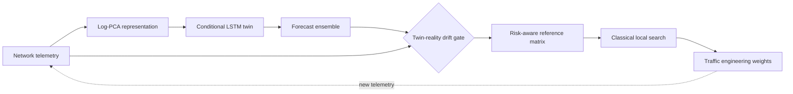
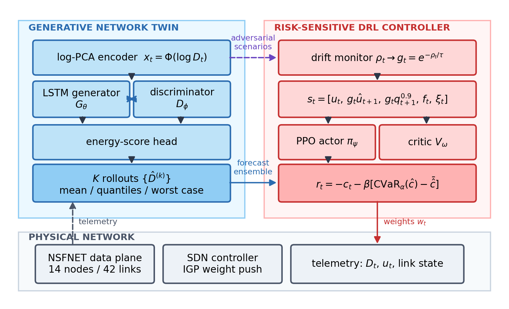
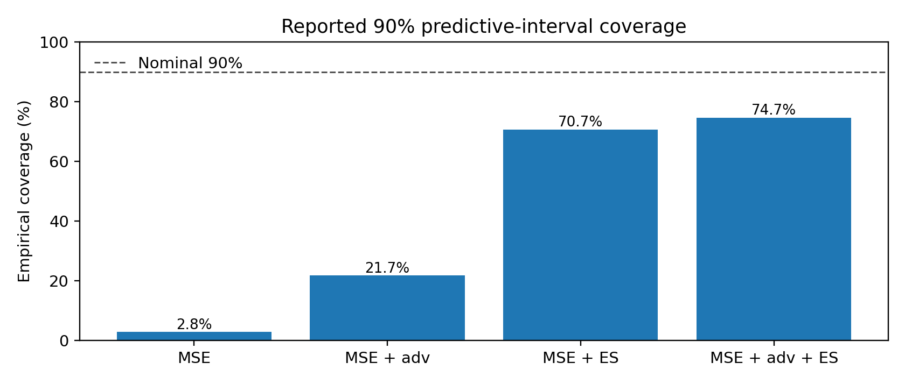
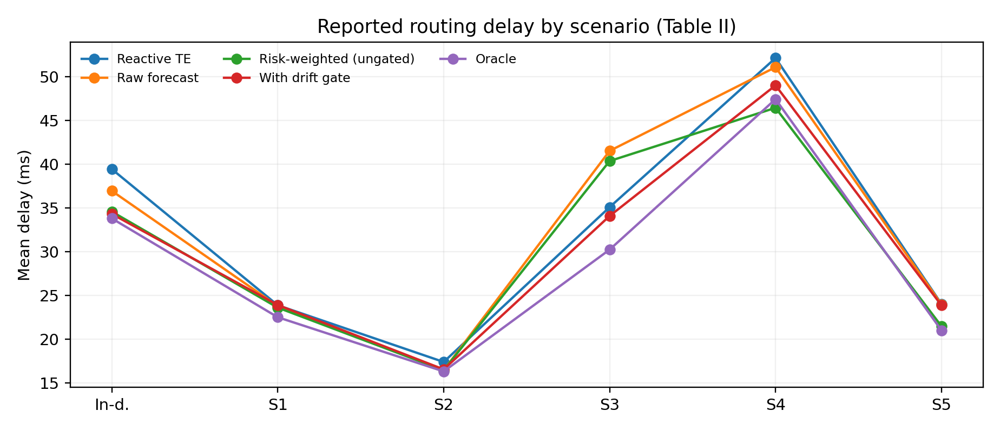
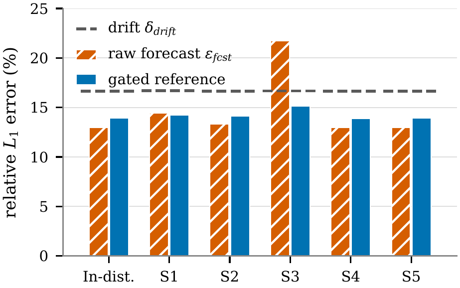
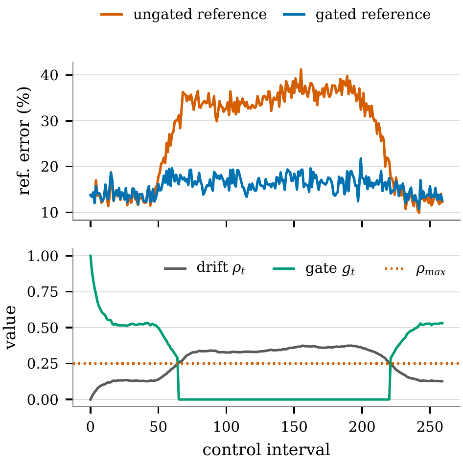

<div align="center">

# Drift-Aware Reference Shrinkage
### Proactive Traffic Engineering with Generative Network Twins

**Accepted research companion · IDCIoT 2027 · Manuscript ID: IDCIoT-068**

[](https://www.python.org/)
[](https://numpy.org/)


[](LICENSE)

**[Start here](#quick-start) · [Numerical results](#selected-manuscript-results) · [Reproducibility status](#reproducibility-status) · [Citation](#citation)**

</div>

---

> **Scientific status.** The study has been accepted for presentation at the 5th International Conference on Intelligent Data Communication Technologies and Internet of Things (IDCIoT 2027), 21–23 January 2027. This repository preserves an executable **lightweight companion** and transcribes results from the revised manuscript, but the included scripts **do not independently recreate all manuscript comparisons**. Acceptance is not a claim of IEEE Xplore publication or completed reproducibility verification.

[📄 IEEE-formatted accepted-author manuscript](paper/manuscript/IDCIoT-068_IEEE_Formatted_Author_Version.pdf) · [📊 Reported tables](paper/reported/) · [🧪 Diagnostic code](src/gnt_repro/)

## Research in one minute

Anticipatory routing replaces current traffic measurements with a forecast of the next control interval. This is useful when the prediction is more dependable than a stale observation. It can also backfire when the network's traffic regime changes after model training.

The manuscript studies a **generative network twin** trained with a probabilistic energy-score objective, combined with a **drift-aware gate** that moves the routing reference from a predictive ensemble toward recent live telemetry when twin-reality disagreement increases. Optimization is performed by a classical local-search controller; the work also evaluates risk-sensitive DRL alternatives.



<div align="center">
  
  <sub>Figure 1 from the accepted author's manuscript. Illustrative research architecture; it is not a diagram of the current compact software implementation in every detail.</sub>
</div>

## Selected manuscript results

The following figures are **replots of Tables I and II in the accepted manuscript**. They are provided to make the published-in-manuscript numbers legible and auditable; they are **not output of an experiment run in this repository**.

| Manuscript observation | Reported figure | Interpretation |
|:--|--:|:--|
| Nominal 90% interval coverage, MSE-only LSTM | **2.8%** | Pronounced undercoverage |
| Nominal 90% interval coverage, full GAN-LSTM | **74.7%** | Improved, but still **15.3 pp below nominal** |
| CRPS, MSE-only → full GAN-LSTM | **0.3377 → 0.2501** | **25.9%** relative reduction |
| S3 delay, risk-ungated → gated | **40.37 → 34.08 ms** | **15.6%** delay reduction on S3 |
| In-distribution oracle-gap closure | **90.9%** | Calculated against the reactive and oracle rows in Table II |

<div align="center">
  
  
</div>

The original source of the numerical entries and all recorded gaps appear in **[`paper/reported/README.md`](paper/reported/README.md)** and **[`docs/reviewer_alignment.md`](docs/reviewer_alignment.md)**. Figure 3's numeric backing data and several Table III cells were not supplied, so they have not been invented.

## Original manuscript figures and reproducibility notes

The five original author-embedded figures are preserved in [the figures folder](assets/README.md), including the following figures whose source data are not present in the compact code:

<div align="center">
  
  
</div>

Their inclusion preserves the paper illustrations; it does not establish the missing underlying numeric traces.

## Architecture and experiments

| Component | Accepted-paper method | Public repository scope |
|:--|:--|:--|
| Synthetic network | NSFNET, 14 nodes, 42 directed links | Network simulator implemented |
| Traffic forecaster | Conditional LSTM, log-PCA traffic model | Lightweight model implemented |
| Probabilistic loss | MSE, adversarial, energy score variants | Energy-score route implemented; full ablation **not** run by current pipeline |
| Drift-aware reference | EWMA twin-reality discrepancy and gate | Lightweight gate implemented |
| Risk-aware traffic engineering | Ensemble tail + randomized local search | Compact prototype implemented |
| Deep reinforcement learning | PPO policy comparisons against classical search | PPO sanity test exists; **full experimental comparison not reproduced** |
| Results under shift | S1–S5, in-distribution and latent-rank criterion | Synthetic scenarios implemented with some non-identical definitions |

## For researchers: optional diagnostic execution

**No execution is required to upload this repository to GitHub.** The commands below are provided only for future users who wish to explore the diagnostic implementation.

### Quick start

**Windows 11** (PowerShell):

```powershell
py -3.12 -m venv .venv
.venv\Scripts\python.exe -m pip install -r requirements.txt
.venv\Scripts\python.exe run_reproduction.py --mode quick --output-dir outputs/quick_local
.venv\Scripts\python.exe scripts/check_manuscript_alignment.py
```

macOS / Linux:

```bash
python3 -m venv .venv
.venv/bin/python -m pip install -r requirements.txt
.venv/bin/python run_reproduction.py --mode quick --output-dir outputs/quick_local
.venv/bin/python scripts/check_manuscript_alignment.py
```

Run tests:

```bash
python -m pytest -q
```

**Important:** The `outputs/` directory is intentionally empty except for its explanation file. Future developer-run diagnostic metrics belong there; the separately archived manuscript values are in `paper/reported/`. These sets must not be conflated.

### Longer available configuration

```bash
python run_reproduction.py --mode paper --output-dir outputs/paper_local --seed 7
```

The command uses the longer configuration supported by the included diagnostic source. It **does not yet certify a complete paper-equivalent reproduction**, including all GAN ablations and DRL controller results. See [protocol](docs/reproduction.md).

## Repository layout

```text
├── src/gnt_repro/                 # Standalone compact experimental modules
├── tests/                         # Model sanity and manuscript-table arithmetic checks
├── run_reproduction.py           # Standalone diagnostic runner
├── run_reproduction.bat          # Optional diagnostic Windows runner
├── outputs/                       # Local diagnostics only, no paper-number claims
├── paper/reported/               # Source-labelled manuscript Table I–III entries
├── assets/                       # Paper figures + table-based visualizations
├── scripts/                      # Reported-table checks and chart generator
├── docs/                         # Protocol, reviewer changes and reproducibility caveats
├── .github/workflows/            # CI checking arithmetic, source smoke tests
├── CITATION.cff                   # Updated public paper authors/title (software citation)
└── RELEASE_NOTES.md              # Accepted-paper record and remaining gaps
```

## Reproducibility status

**The strongest correct public claim today is: the repository provides an inspectable companion implementation and independently checkable transcriptions of the accepted paper's reported tables.** A full rerun giving identical manuscript results is **not yet demonstrated** by its current pipeline.

Known limitations:

- Only synthetic traffic and one NSFNET topology are reported; no operational trace validation or second-topology evidence.
- One training seed was used for each reported variant; statistical uncertainty of small improvements is unresolved.
- Reported nominal 90% predictive intervals achieve 74.7% coverage; CVaR tail estimation uses only two of the eight controller rollouts.
- S5 is described as a **dual-link failure** in the manuscript but as a mild traffic perturbation in the included lightweight `traffic.py`. This must be reconciled with original study artifacts rather than silently patched after acceptance.
- The included source does not reproduce the full GAN/DRL suite or paper-equivalent quick-run metrics.
- Missing Table III entries and original Figure 3 backing data require author verification.

See [standalone source scope](docs/source_scope.md), [full reproduction notes](docs/reproduction.md), [manuscript change register](docs/reviewer_alignment.md), and [release checks](docs/release_checks.md).

## Authors and acknowledgment

Jasmine Kaur · Bashar Aswad Kokaz Al-Saeedi · **Alok Raj** (corresponding author) · Pankaj Vaidya · Anurag Rana  
Yogananda School of AI, Computers and Data Sciences, Shoolini University of Biotechnology and Management Sciences, Solan, India.

**Funding:** No external funding is asserted here. The paper's author contribution statements and publication disclosures should follow the signed submission documents.

## Citation

**Paper:** *Drift-Aware Reference Shrinkage for Proactive Traffic Engineering with Generative Network Twins*, accepted at **IDCIoT 2027**, manuscript ID **IDCIoT-068**. No DOI or final IEEE Xplore metadata has yet been verified.

Use [`CITATION.md`](CITATION.md) for a provisional BibTeX entry and [`CITATION.cff`](CITATION.cff) to cite this repository as software.

## License

The included diagnostic source is distributed under the [MIT license](LICENSE). This standalone packaging does not claim to be the complete private/original experiment archive, nor does it transfer authorship of pre-existing concepts or materials. Research figures and manuscript content are shared subject to the authors' and conference publisher's rights.
